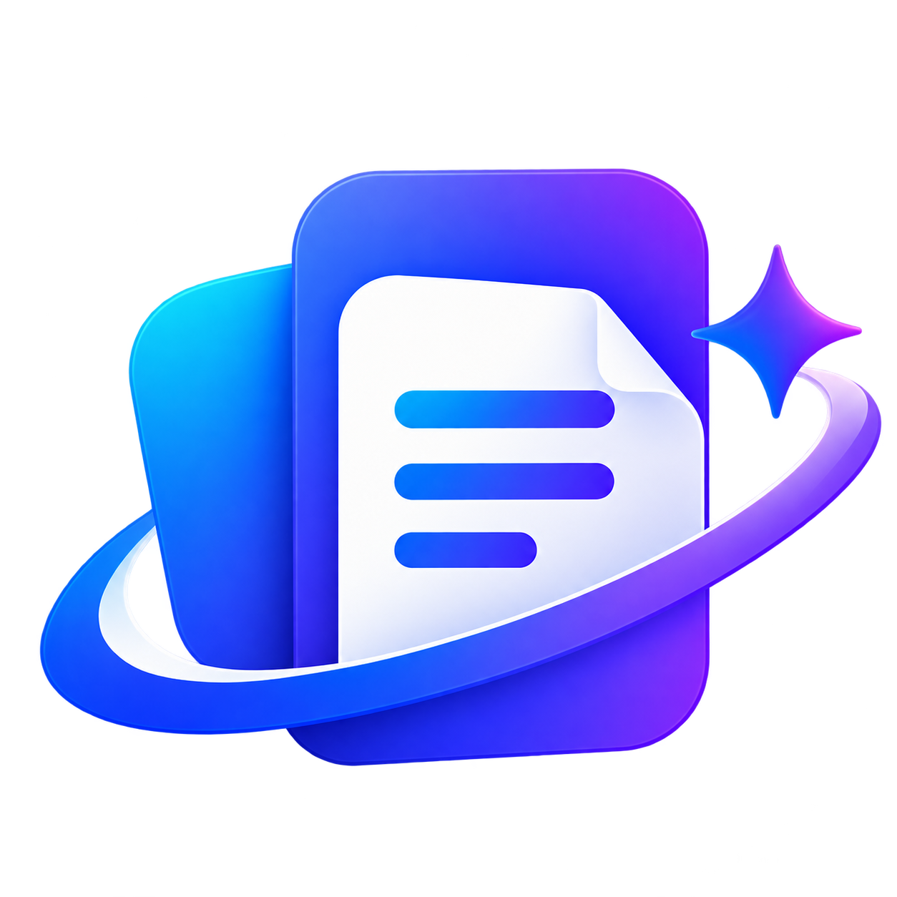
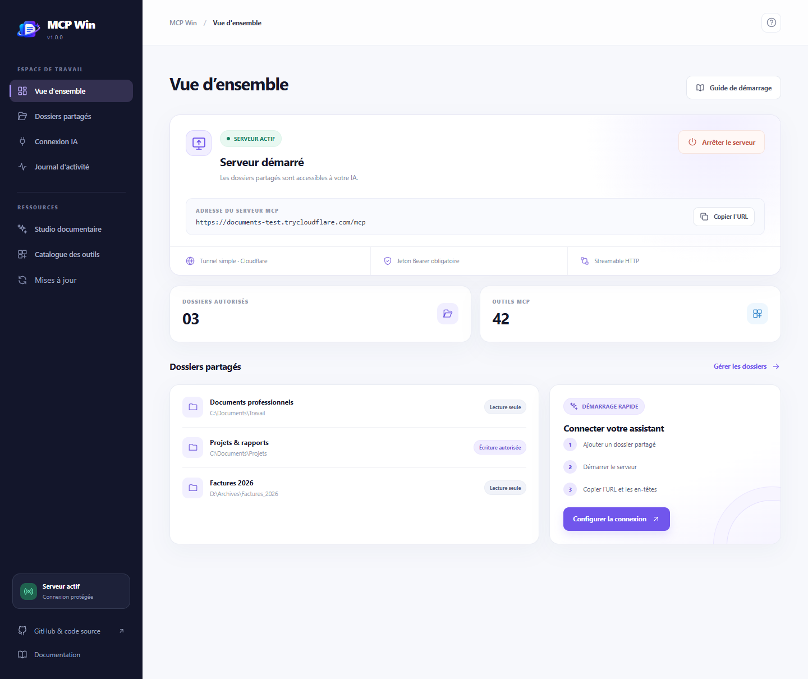

<p align="center">
  
</p>

<h1 align="center">MCP Win</h1>

**MCP Win est une application Windows gratuite et open source qui permet à votre assistant IA de lire, rechercher, créer et modifier les documents dans les dossiers de votre ordinateur que vous choisissez de partager.**

Ajoutez un dossier, démarrez le serveur et connectez votre assistant avec l’URL MCP et son jeton. Il peut alors travailler sur vos PDF, Word, Excel, PowerPoint, images et fichiers texte, même à distance. L’assistant doit prendre en charge **MCP distant / Streamable HTTP** et l’en-tête **Authorization**.

<p align="center">
  <a href="https://github.com/extraopaa/mcp-win/releases/tag/v1.0.0"><strong>Télécharger la V1 — Orbite · Windows x64</strong></a>
  &nbsp;·&nbsp; <a href="docs/wiki/Home.md">Guide utilisateur</a>
  &nbsp;·&nbsp; <a href="CHANGELOG.md">Changelog</a>
</p>



## Ce que votre IA peut faire

| Usage | Fonctionnalités |
| --- | --- |
| Trouver l’information | Recherche récursive, filtres glob, index local persistant, extraits, plans et références avec page ou feuille et empreinte du fichier. |
| Produire des documents | PDF, DOCX et PPTX avec mise en page professionnelle par défaut ; nouveaux classeurs XLSX mis en forme. |
| Respecter votre identité | Profils avec logo, couleurs, police, coordonnées et pied de page ; modèles Typst et Office. |
| Lire des scans | OCR français/anglais local, blocs, champs et tableaux estimés, export CSV/XLSX. |
| Corriger précisément | Éléments identifiés, modifications ciblées, propositions à comparer et valider, sauvegardes et annulation. |
| Enchaîner les tâches | Workflows avec progression, pause, reprise et annulation groupée des fichiers produits. |
| Traiter les fichiers existants | Fusion et extraction de pages PDF, formulaires, archives ZIP/TAR/7z et requêtes SQLite/DuckDB en lecture seule. |
| Vérifier le résultat | Contrôles qualité, rendu des pages PDF et aperçus pour l’assistant. |

**42 outils MCP**, regroupés dans une application Rust/Tauri avec les moteurs embarqués. Microsoft Office et une API d’IA payante ne sont pas nécessaires. Vous utilisez votre propre assistant IA ; aucun modèle n’est inclus.

> Exemple : « Retrouve les devis du projet, compare les montants en citant tes sources, puis crée un rapport PDF et un tableau Excel. »

## Installer et connecter

1. [Téléchargez le paquet Windows x64](https://github.com/extraopaa/mcp-win/releases/download/v1.0.0/mcp-win-v1.0.0-windows-x64.zip) et **extrayez toute l’archive**. Gardez le dossier `engines` à côté de `MCP Win.exe`.
2. Ouvrez l’application et ajoutez un dossier. Il est en **lecture seule par défaut** ; arrêtez le serveur pour autoriser l’écriture avec le bouton **Droits**.
3. Choisissez **Tunnel simple** pour Cloudflare sans compte, **Mon propre relais** pour frp, ou **Local uniquement**.
4. Démarrez le serveur. Dans votre assistant, ajoutez l’URL MCP et collez le contenu de **Copier les headers JSON** dans les en-têtes sécurisés.

```json
{"Authorization":"Bearer <votre jeton>"}
```

Le bouton **Copier Bearer + jeton** fournit la valeur complète pour un champ Authorization. Le PC et l’application doivent rester allumés. Arrêter le serveur coupe l’accès.

**Prérequis :** Windows x64 et Microsoft Edge WebView2. Le paquet est portable : aucun installateur ou compte MCP Win à créer.

## V1 — Orbite

La première version majeure réunit le nouveau **Studio documentaire**, la mise en page professionnelle par défaut, les profils visuels, la recherche persistante, l’OCR structuré, les workflows et les révisions contrôlées.

La recherche de **mises à jour** est automatique au démarrage et toutes les six heures. L’installation se lance depuis l’application, serveur arrêté, avec signature Ed25519 et vérification du paquet avant remplacement. Les préférences sont conservées. Les anciennes versions sans updater nécessitent une première installation manuelle.

[Détail de la V1 et limites](docs/V1.md) · [Mises à jour signées](docs/UPDATES.md) · [Historique des versions](CHANGELOG.md) · [Noms des versions majeures](docs/RELEASES.md)

## Sécurité et confidentialité

- **Jeton Bearer obligatoire** dans tous les modes. L’URL seule ne donne pas accès aux dossiers.
- Les connexions extérieures utilisent HTTPS et un tunnel chiffré. **Le relais peut lire les données qu’il transmet** ; ce n’est pas du chiffrement de bout en bout jusqu’à l’assistant.
- Seuls les dossiers choisis sont accessibles. L’écriture est une autorisation distincte, modifiable depuis l’application lorsque le serveur est arrêté.
- L’OCR et la génération s’exécutent sur votre PC. Les contenus lus sont transmis à votre assistant IA.
- Préférences, jetons, index et propositions sont stockés localement, sans chiffrement au repos. Le stockage privé et l’historique sont exclus des outils MCP distants.
- La recherche de mises à jour contacte GitHub, sans transmettre vos documents ou votre jeton MCP.

Le code et les moteurs sont libres. Le client `cloudflared` est open source ; **le réseau Cloudflare reste un service tiers gratuit**, avec adresse temporaire et sans garantie de disponibilité. Un [relais personnel](relay/README.md) est également pris en charge.

[Rapport de sécurité](docs/SECURITY-V04.md) · [Vérifications effectuées](VALIDATION.md)

## Limites à connaître

Les documents sont limités à **25 Mio**. Les lectures, recherches et listes sont paginées pour limiter le contexte de l’IA. L’OCR structuré reste une estimation à vérifier, notamment sur les tableaux complexes et les scans dégradés. Les formules Excel sont stockées sans recalcul automatique.

Les PDF peuvent être rendus et contrôlés visuellement. Les contrôles Office portent sur la structure ; le rendu final dépend du lecteur. Les anciens formats DOC/PPT ne sont pas interprétés, et aucune conversion universelle n’est promise.

## Documentation

- [Premiers pas et connexion IA](docs/wiki/Home.md)
- [Les 42 outils et leurs formats](docs/MCP-TOOLS.md)
- [Composition avancée, Typst et OCR](docs/AUTHORING.md)
- [Studio, index, workflows et révisions](docs/V1.md)
- [Compilation et contribution](CONTRIBUTING.md)

## Compiler

Installer Rust stable MSVC, les outils C++ Windows, CMake et WebView2, puis :

```powershell
./scripts/fetch-frp.ps1
./scripts/fetch-engines.ps1
./scripts/fetch-cloudflared.ps1
./scripts/fetch-duckdb.ps1
cargo fmt --check
cargo test --locked
./scripts/package.ps1
```

Aucun build frontend ni npm n’est requis pour l’application. Le paquet complet est généré dans `dist/`. Les moteurs téléchargés sont épinglés et leurs empreintes sont vérifiées.

## Licence

Le code de MCP Win est sous [licence MIT](LICENSE). Les dépendances et moteurs conservent leurs licences respectives : [notices tierces](THIRD-PARTY-NOTICES.md). Les documents privés, préférences, exécutables générés et clés de signature ne sont pas versionnés.
